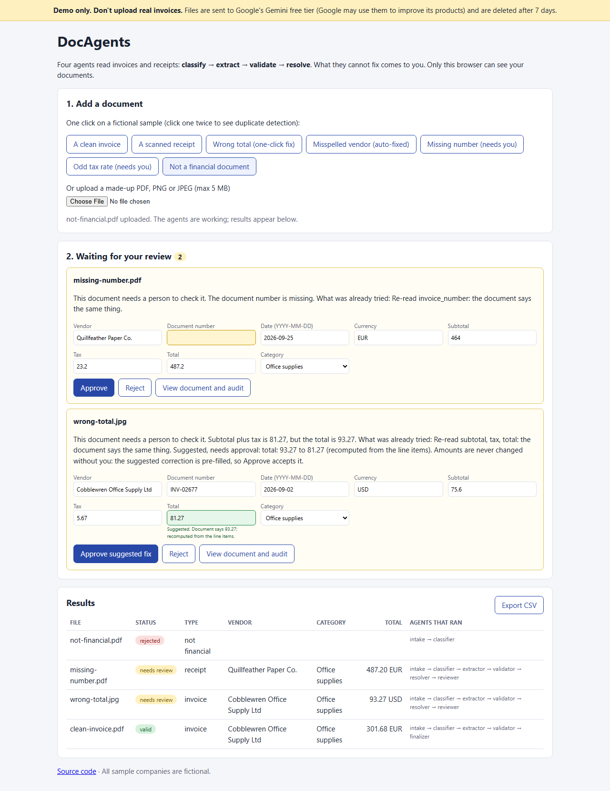
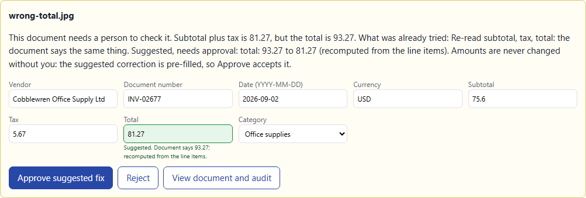
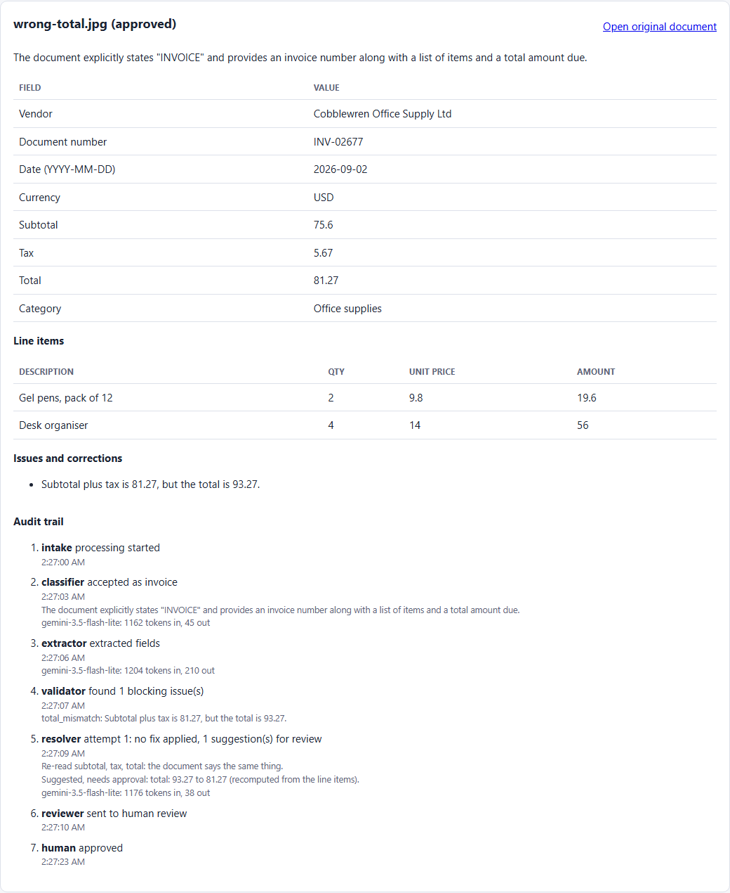
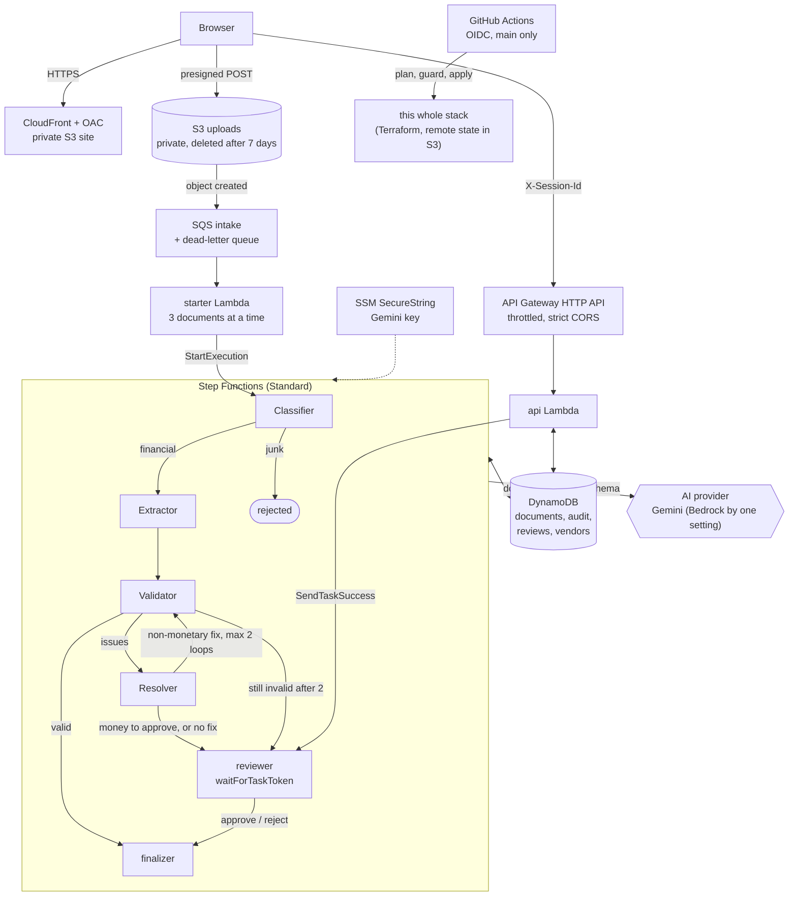

# doc-agents-aws

**Four AI agents on AWS that read invoices and receipts, check them, fix what is safe to fix, and hand the rest to a person with a plain-English explanation. Money is never changed without one. Serverless, deployed with Terraform, measured agent by agent.**

**Live demo: <https://dqzyienf3t29b.cloudfront.net>**: click a fictional sample and watch it move through the agents. Demo only: don't upload real invoices.

Project 2 of my AI portfolio. Project 1: [rag-on-aws](https://github.com/usmanibrahim17/rag-on-aws), whose provider interface, queue pacing, deploy guard and OIDC setup are reused here.



| Human review | Audit trail |
|---|---|
|  |  |

## What it does

| Agent | Job |
|---|---|
| **Classifier** | Invoice, receipt, credit note, or not a financial document. Junk is rejected with a reason |
| **Extractor** | Reads PDF or photo into a fixed JSON schema: vendor, number, date, currency, line items, subtotal, tax, total, expense category |
| **Validator** | Rules first (arithmetic, tax rate, required fields, duplicates, known vendor), then an AI anomaly check on documents that pass |
| **Resolver** | Re-reads the problem fields, fuzzy-matches misspelled vendors, recomputes totals. Non-monetary fixes are applied and go back to the Validator (at most 2 loops); **monetary fixes are suggested for one-click approval** |

Whatever remains goes to a person: the workflow pauses, shows what is wrong and what was already tried, and resumes on approve or reject. Every decision is written to an audit log; saved documents export as CSV.

## Architecture

As deployed in `us-east-1`:



Each box in the workflow is its own Lambda with its own IAM role. Agent Lambdas raise `RateLimited` on HTTP 429 and the state machine retries with exponential backoff and jitter.

## Key decisions

| Decision | Why |
|---|---|
| **Rules before AI** in the Validator | Arithmetic, tax and duplicates are exact, free and explainable; the model only judges what rules cannot, and only on documents that passed them |
| **Step Functions Standard** with `waitForTaskToken` | A document can wait days for a person with nothing running |
| **Money needs a person** (default) | A change to a total, subtotal, tax, currency or line amount is only suggested, pre-filled with the reason. `auto_fix_monetary_amounts = true` lets the Resolver apply it instead |
| Resolver **only proposes what evidence supports** | A total is recomputed only when every line is internally consistent; old and new values stay in the audit log |
| Loop ends when **nothing changed** (or after 2 loops) | No repeated model calls that cannot help |
| **SQS + a starter Lambda** in front of the workflow | A burst of uploads waits in line (`ChangeMessageVisibility` backoff) instead of hitting the free-tier limit together |
| **Pluggable provider** (`gemini` or `bedrock`) | Bedrock on-demand quota is 0 on this account. The Bedrock path is tested with stubs only |
| Plain Python + `boto3`; PDFs and images go to the model as they are | No frameworks, OCR service or PDF library; one small zip |
| **Anonymous session per browser** | A public demo with no sign-up where visitors cannot see each other's documents |

## Evaluation

33 synthetic documents (30 financial, 11 images, 3 non-financial) for fictional companies, with deliberate faults: wrong totals, duplicates, missing fields, misspelled vendors, odd tax rates and an unknown vendor. Each is rendered from its ground-truth record. Full report: [`evals/RESULTS.md`](evals/RESULTS.md).

| Agent | Metric | Result |
|---|---|---|
| Classifier | Document type accuracy | 100% (33 documents) |
| Extractor | Field accuracy / line items / category | 100% / 100% / 100% (30 documents) |
| Validator | Precision / recall | 100% / 100% (14 bad, 16 good) |
| Resolver | Non-monetary fixes applied correctly (misspelled vendors) | 3 of 3 |
| Resolver | Wrong totals: right correction suggested for approval | 3 of 3 |
| Resolver | Unfixable documents sent to a person | 8 of 8 |
| Resolver | Saved without a person | 21.4% (3 of 14 flagged) |
| Resolver | Amounts changed without a person | 0 |
| Pipeline | Latency, one document (median of 5, max) | 5.3 s (6.9 s) |
| Pipeline | Latency when 31 arrive at once (p50 / p95) | 97 s / 243 s, mostly queueing |

**How to read this.** The 100% scores mean the pipeline handles this set, not that it is error-free. The documents are machine-rendered and clearly printed (scans add only slight rotation, noise and blur), the set is small, and the same author wrote the data, the rules and the pipeline. Expect lower scores on creased photos, handwriting and unusual layouts. Few documents are saved without a person by design: 11 of the 14 faulty ones need one, either to approve a changed amount or to supply what is missing. An earlier run that let the Resolver change totals itself saved 6 of 14; both runs are in the history table.

**Real photos:** [`evals/photos/`](evals/photos/README.md) holds a second set, photographs of ten printed documents scored against the same ground truth and reported as a separate row. The photos have not been added yet, so there is no result.

A [burst test](evals/LOAD_TEST.md) of 20 simultaneous uploads finished all 20 in 366 s with nothing lost or dead-lettered.

## Cost per 1,000 documents

Measured in the eval run: 1,944 input and 292 output tokens, 8.5 state transitions and 2.83 Lambda GB-seconds per document.

| Option | Models | AWS | **Total per 1,000 documents** |
|---|---|---|---|
| Gemini free tier (demo and public data only) | $0.00 | $0.30 | **$0.30** |
| Gemini paid (`gemini-3.5-flash-lite`) | $1.31 | $0.30 | **$1.61** |
| Amazon Bedrock Nova Lite (estimate, not run) | $0.19 | $0.30 | **$0.48** |

AWS share: Step Functions $0.21, Lambda $0.05, DynamoDB $0.02, S3 + SQS $0.01, API Gateway $0.01. List prices without free-tier allowances; DynamoDB, S3, SQS and API request counts per document are assumptions; logs, CloudFront, transfer and storage are excluded. Prices and sources are in [`evals/cost.py`](evals/cost.py). Nothing runs all the time: when idle, the charges are storage and the queue polling.

## Security

- **Least-privilege IAM:** one role per Lambda, scoped to specific tables, prefixes, queue, state machine and the one SSM parameter. One exception: Step Functions task callbacks have no resource-level permissions, so the API role has `states:SendTaskSuccess` on `*`; the task token is what authorizes a resume.
- **Permissions boundary** on every stack role. The CD role may only create or change `docagent-*` roles that carry it, and cannot edit the boundary or itself. It can manage any CloudFront distribution and HTTP API in the account, because their IDs are random.
- **Visitor isolation:** every upload, list, detail, audit, review and export is scoped to an anonymous session id; another session's document returns 404. Task tokens stay server-side. The session id is a bearer secret, not a login.
- **Private storage:** uploads and site buckets block public access and are encrypted; the site is served only through CloudFront (OAC) with CSP, HSTS and frame headers. CORS allows the site's origin only.
- **Retention:** uploads are deleted after 7 days; documents, reviews and audit records expire through DynamoDB TTL.
- **Abuse limits:** API throttling (5 requests/s, burst 20), 5 MB PDF/PNG/JPEG only, daily upload caps. A determined visitor could still use up the day's shared cap.
- **Untrusted content:** prompts treat document text as data; output must match a schema; the page renders it as text only; CSV export neutralizes spreadsheet formulas.
- **No secrets** in code, Terraform variables, state or logs. The Gemini key is read from SSM at runtime. CI uses GitHub OIDC with this repository's immutable subject claim: no stored AWS keys.
- **Deploy guard:** CD refuses any plan that deletes or replaces resources unless the commit message contains `[allow-destroy]`.
- **Data privacy:** Google may use free-tier inputs to improve its products. For client documents use a paid Gemini key or Bedrock.

## Problems solved

1. **Paused reviews would have blocked the queue.** An execution waiting for a person still counts as running, so the starter subtracts pending reviews before deciding whether there is a free slot.
2. **Auto-fixing money is risky.** The first version corrected wrong totals by itself. Now it prepares the correction and a person accepts it with one click, unless the client switches that on.
3. **Duplicates in a public demo.** The duplicate key includes the session, so two visitors trying the same sample do not flag each other.
4. **Rate limits without paying to wait.** Instead of sleeping in a Lambda, agents fail fast on 429 and Step Functions backs off.
5. **A circular dependency** between the site's security policy (needs the API address) and the API's CORS (needs the site address), broken by allowing the API Gateway domain pattern in the policy.
6. **The first automated deploy failed** because Windows PowerShell stripped the quotes from a list-valued CI secret; setting it through standard input fixed it.

## Deploy your own

Needs an AWS account (`us-east-1`), Terraform 1.10+, Python 3.12 and a [Gemini API key](https://aistudio.google.com/apikey).

1. Store the key (never in code or tfvars): `aws ssm put-parameter --name /rag-demo/gemini-api-key --type SecureString --value <key>`
2. The bootstrap expects a private, versioned S3 **state bucket** and the account's **GitHub OIDC provider**. [rag-on-aws](https://github.com/usmanibrahim17/rag-on-aws)'s bootstrap creates both; otherwise create them once yourself.
3. `cd infra/bootstrap && terraform init && terraform apply -var state_bucket_name=<bucket> -var github_sub_prefix=<prefix>` (read the prefix with `gh api repos/<owner>/<repo>/actions/oidc/customization/sub --jq .sub_claim_prefix`).
4. In `infra/envs/demo`, copy `terraform.tfvars.example` and `backend.hcl.example` without the `.example` suffix and fill them in.
5. From the repository root: `python scripts/build_zip.py`, then `cd infra/envs/demo && terraform init "-backend-config=backend.hcl" && terraform apply`
6. Open `terraform output web_url`.
7. Continuous deployment: set repository variables `AWS_DEPLOY_ROLE_ARN`, `AWS_REGION`, `TF_STATE_BUCKET` and the secret `BUDGET_ALERT_EMAILS` (a list such as `["you@example.com"]`).
8. Measure it: `pip install -r requirements-dev.txt`, then `python evals/run_evals.py --url <api_url>`. Browser test: `scripts/demo_browser_test.py`.

## Repository layout

```
app/agents/    classifier, extractor, validator, resolver, reviewer, finalizer
app/api/       public API          app/starter/   SQS -> Step Functions
app/common/    providers (Gemini + Bedrock), rules, schemas, audit
statemachine/  workflow definition
infra/         bootstrap (deploy role, boundary), modules/docagent_stack, envs/demo
web/           static demo site and samples (no framework, no build step)
evals/         dataset, scoring, cost, results
scripts/       build, dataset generator, load and browser tests
tests/         unit tests
```

All companies and documents in this repository are fictional.
